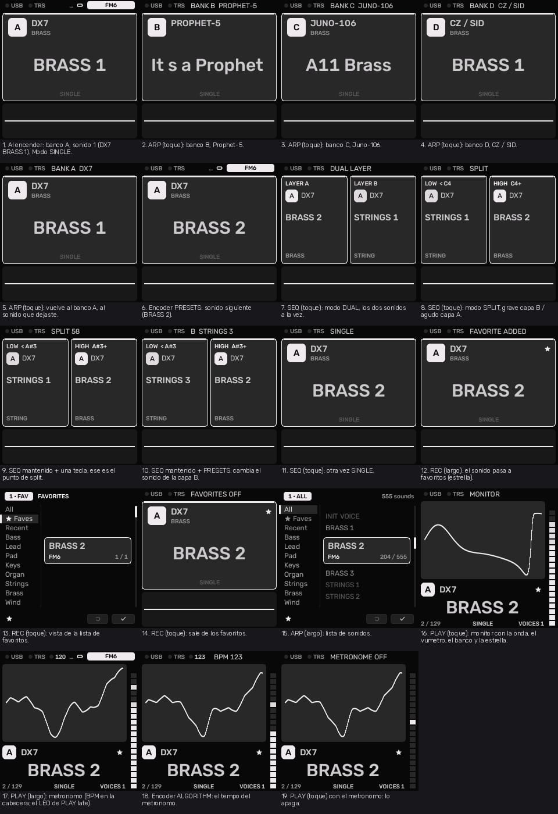

# Vintage Module

Custom firmware for the M-VAVE FM-1. This is a streamlined, "synth-only" modification focused entirely on pure sound design and live performance, removing all sequencing and arpeggiation clutter to optimize processing for the synthesizer engines.

## Core Features

## Features

VintageModule is custom firmware for the **M-VAVE FM-1** (JieLi AC791N). It turns the FM-1 into a polyphonic synth with six sound banks, two layers (dual and split modes), three effect slots, an arpeggiator, and a USB and DIN MIDI input that is always on.

### Sound banks

Six banks, each with its own factory sounds. A short press of **SCL** moves to the next bank, and the bank remembers the sound you last used in it.

| Bank | Engine |
|------|--------|
| A | **DX7**: 6-operator FM (algorithms, per-operator rates and levels, pitch EG, LFO, keyboard scaling and curves) |
* *Native Storage:* Natively stores 128-byte packed Dexed/DX7 voices into slots F001–F064.
* *SysEx Support:* Accepts direct SysEx cartridge dumps over USB without needing external unpacking.
* *Controls:* Direct control over Master Level, Master Rate, Envelope Generator, and Detune.
| B | **PROPHET-5**: analog-style polysynth with its own oscillator, filter, envelope, poly-mod, wheel and unison pages |
* *Factory Patches:* Includes all 200 factory programs from Sequential's v1.03 bank.
* *User Memory:* 128 native user slots (P001–P128) for custom sound design.
* *Modelling:* Features fractional state SSI (Rev 1/2) and Curtis (Rev 3) four-pole filter emulations, Poly-Mod, and hard sync.

| C | **JUNO-106** |
* *Complete Emulation:* Ported and integrated from the FM-106 architecture.
* *Presets:* Includes *all official factory presets* pre-loaded and ready to play.
| D | **CZ-1 / SID**: Casio CZ-style phase distortion (two lines, DCW/DCA/DCO envelopes, vibrato, detune, window) and a SID-style engine |
* *Casio CZ-1:* Includes 64 classic native CZ preset tones with Phase Distortion synthesis continuously evaluated via FPU.
* *Commodore SID:* Register-level emulation of the MOS 6581/8580 chips featuring 32 factory presets, pulse width modulation, combined waveforms, and filter curves.

| E | **JUPITER 08 MINI** |
| F | **OBERVAVE** (single mode only) |

### Layers: Single, Dual and Split

A short press of **SEQ** cycles through three modes:

- **SINGLE**: one sound (layer A, the main layer).
- **DUAL**: two sounds play together (layer A main, layer B secondary), each with its own voices.
- **SPLIT**: notes below the split point play layer B, notes from it up play layer A.

The split point and layer B's sound are remembered, but the unit always starts in SINGLE mode.

### Sound browser and presets

- **Hold SCL**: opens the sound list of the bank you are using, with no categories or favourites.
- **PRESETS** (SAVE family): the full browser with **ALL**, **favourites**, **RECENT** and categories. Turn the sound knob to browse; fast turns accelerate and the sound loads when the knob rests. **OCT-** goes back to the sound from before the browser, **OCT+** keeps the sound shown.
- **Favourites**: mark any sound with the star; a short press of **REC** shows the favourites view.
- **User presets**: save, load and erase your own sounds in numbered slots, and rename them with the on-screen name editor.
- **Projects**: several project slots, with an option for the project that loads at power-on.

### Sound shaping (every layer)

- **Voice**: polyphony and allocation, glide (with modes), detune, spread, pan, priority, mute.
- **Envelope**: ADSR with display, and envelope destinations (filter, pitch, shape).
- **Two LFOs**: rate, waveform, phase, fade, sync, trigger and polarity, with their own destinations (pitch, filter, shape, amplitude).
- **Modulation matrix**: sources are LFO, ENV, velocity, key, random, mod wheel, aftertouch, expression, S&H and slew.
- **Engine edit pages**: every engine has its own parameter pages, so you can edit each sound on the unit.

### Effects

Three effect slots per layer. Each slot has a type, a mix, a rate and a character control. Types: **PHASER**, **WIDTH**, **FORMANT**, **TAPE**, **SPIT**, **ECHO**, **ROOM**, **REVERB**, **CHORUS**.

### Arpeggiator

Modes: **UP, DN, UPDN, RND, ORD, REPEAT**. It also has rate, octave range, gate, swing, probability, hold and order.

### Mixer (GLO button)

The mixer shows the two layers side by side, each taking half of the screen, with level, pan, mute and a level meter. Pressing GLO again moves through the global pages.

### Global pages

- **GLOBAL**: A4 tuning reference, sustain pedal polarity (`+` or `-`), velocity curve (**SOFT**, **LIN**, **HARD**), and a live CPU load readout.
- **PITCH**: per-layer octave shift (-2 to +2) and semitone shift (-12 to +12), applied to both the keys and incoming MIDI.
- **MIDI**: MIDI channel of the main layer and of the secondary layer, each **OMNI** or 1-16.

All global settings are saved and restored at power-on.

### MIDI

- USB MIDI and DIN (TRS) MIDI are both always on.
- Note on/off, velocity (with the selectable curve), pitch bend (with RPN bend range), mod wheel, sustain pedal, aftertouch, all-notes-off and reset-all-controllers.
- Per-layer channels (see **MIDI** page above); in dual and split modes each layer keeps its own bend, wheel and pedal state.
- Standard CCs control common sound parameters (for example CC5 glide, CC7 level, CC10 pan, CC71/74 filter and macros, CC72/73/75 envelope).

### Performance and monitoring

- **Monitor view**: large waveform, output level meter, loaded sounds with their bank, number and star, the current mode and voice count.
- **PLAY** held: panic (all notes off).
- **System menu** (hold HOME): colour palette, lights, knob acceleration, USB audio options and about information.

### USB audio

USB audio output is available from the System menu.
---

## Keyboard Modes (Split & Layer)

Reshaping the multi-timbral capability of the hardware, VintageS handles layers cleanly. *Layer B is always the track/channel immediately following the selected track (Layer A).* Because each track already runs an independent engine instance, polyphony is not split in half; each engine preserves its own full processing capabilities.

* *SINGLE:* Standard operation. Only Layer A (the selected track) sounds.
* *DUAL:* Every key triggers both Layer A and Layer B simultaneously. Layer B can use its own independent scale and octave transposition.
* *SPLIT:* Notes below the split_point route exclusively to Layer B, while notes from the split point upward route to Layer A.

### Hardware Interface & UI Controls (ui_input.c)
The physical SEQ and ARP layout has been completely re-mapped to handle the performance modes and browser utilities:
* *Short Press (SEQ):* Cycles sequentially through SINGLE ➔ DUAL LAYER ➔ SPLIT. The screen updates to display the active mode.
* *Held SEQ + Key Press:* Sets that specific key as the new split_point and automatically switches the mode to SPLIT (e.g., displaying SPLIT 60). The key marking the split point illuminates while SEQ is held. The split point persists across power cycles (the active mode resets to SINGLE).
* *Held SEQ + PRESETS Encoder:* Adjusts and assigns the sound patch for Layer B independently.
* *SEQ LED Feedback:* 
  * *SINGLE:* LED Off.
  * *DUAL:* LED Solid On.
  * *SPLIT:* LED Blinking (synchronised to the internal tempo clock).
* *ARP Button Quick Actions:* Short press skips to the next preset program with an automatic loop wrap-around (128 ➔ 1). A long press opens the comprehensive global Bank Selection Menu.

Note: Since the sequencer pages are removed, the internal tempo clock remains locked to its last saved value. If you need to adjust it, please use an external MIDI clock source.

---

VintageS organizes its synthesis architecture into 4 dedicated sound banks featuring legendary vintage hardware emulations:

## Installation

### Method 1: Web Installer (Recommended)
1. Connect your M-VAVE FM-1 to your computer via *USB*.
2. Open the web installer using *Google Chrome* or *Microsoft Edge*.
3. Choose the *Synth only* build option.
4. Press *Install* and wait for the verification to finish.

### Method 2: Terminal Installation
For developers and advanced users, install directly from the terminal via Python:
bash
python tools/fm1_install.py

Note: Use at your own risk. You can safely return to the official stock firmware at any time using M-VAVE's official updater or by selecting "Return to official V15" in the web installer.

## Credits & License

* *Developer:* Developed and modified by Ellic Studio / jazzfolderPARLA.
* *Based on:* Modified from [Melodee](https://github.com) by Kerem Kilic and [Felucca](https://github.com) by Leo Kuroshita (Hügelton Instruments).
* *License:* Free software under the *GPL-3.0-only* license.

---
M-VAVE and FM-1 are trademarks of their respective owners. VintageS is an independent open-source project and is not affiliated with or endorsed by them.
